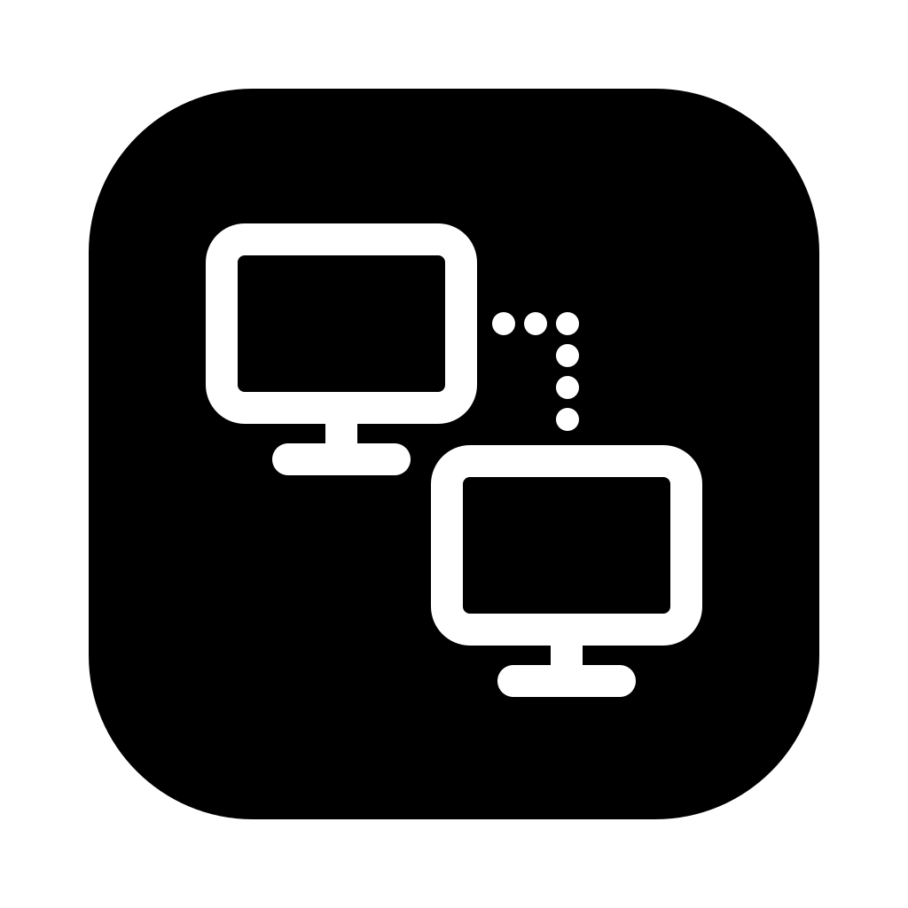
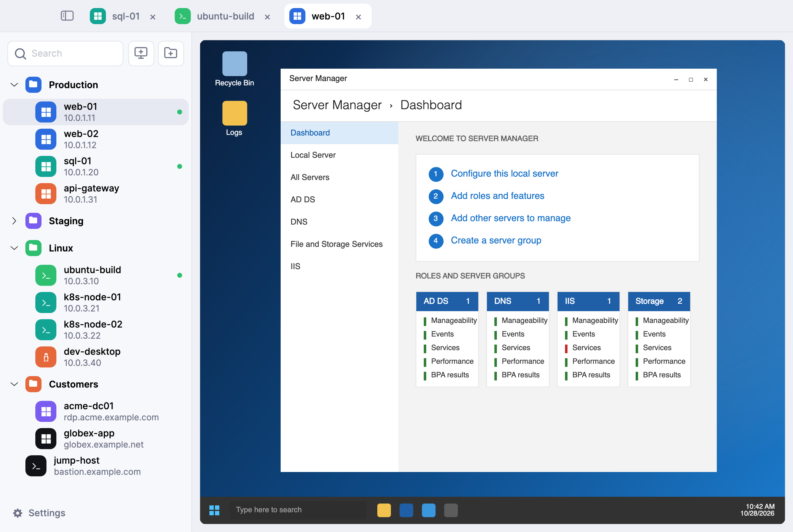
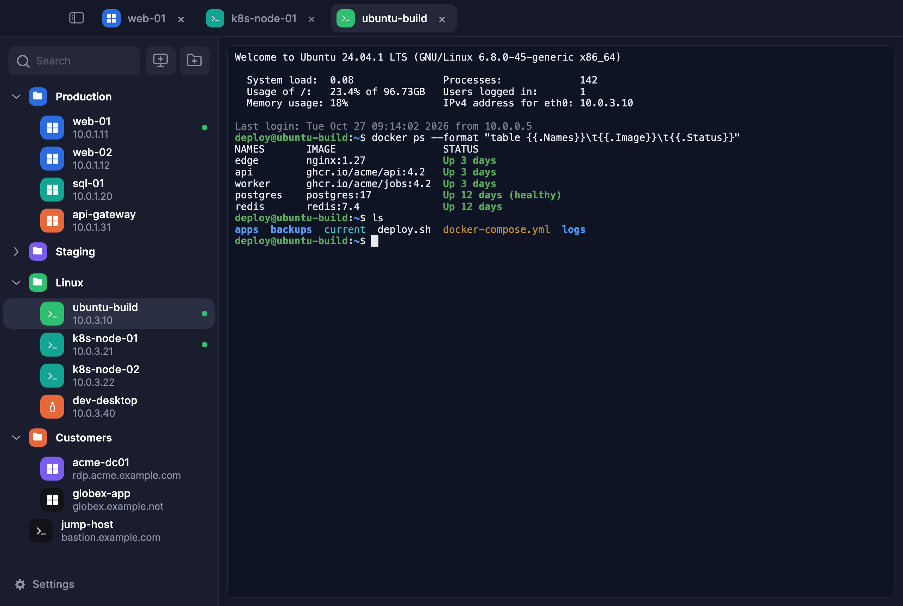
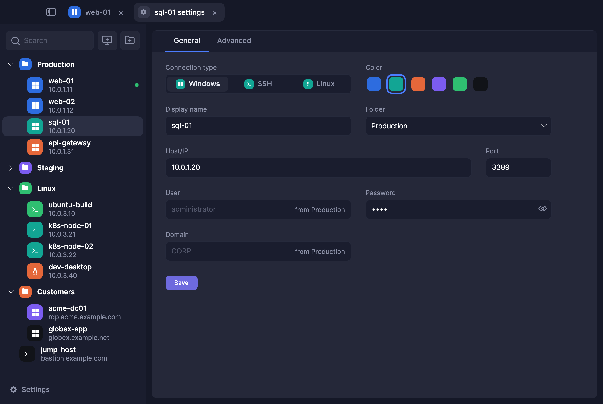
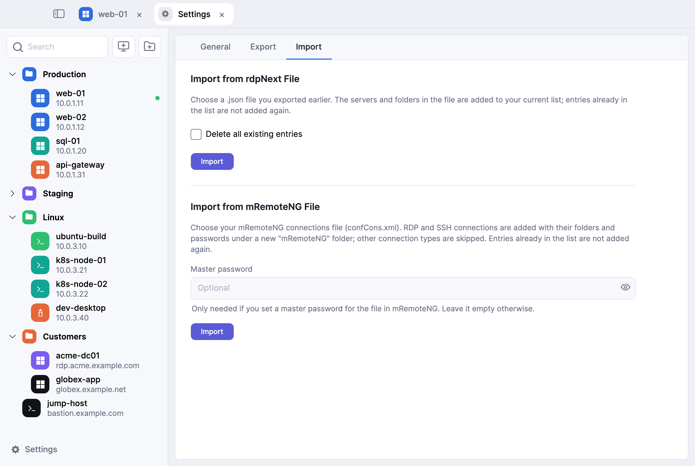
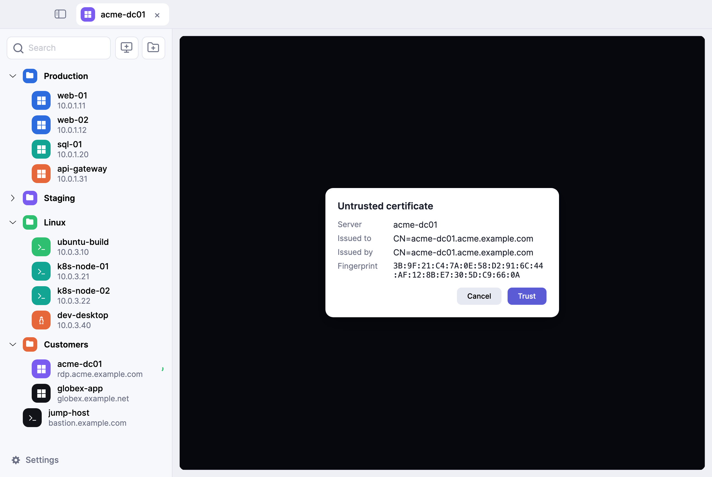

<p align="center">
  
</p>

<h1 align="center">rdpNext</h1>

<p align="center">
  <b>A fast, modern RDP and SSH client for macOS and Windows.</b><br>
  Every server in one tidy sidebar, every session in its own tab.
</p>

<p align="center">
  <a href="https://avvamobile.github.io/AvvaMobile.rdpNext/">Website</a> ·
  <a href="https://github.com/AvvaMobile/AvvaMobile.rdpNext/releases/latest">Download</a> ·
  <a href="https://github.com/AvvaMobile/AvvaMobile.rdpNext/issues">Issues</a>
</p>

<p align="center">
  
  
  
</p>

<picture>
  <source media="(prefers-color-scheme: dark)" srcset="site/images/main-dark.png">
  
</picture>

## Features

**Sidebar**
- All connections in one sidebar, grouped in folders and tagged with a color.
- Type to filter, press <kbd>Enter</kbd> to connect to the first match.
- Single click selects, double click connects; drag and drop to reorder.
- Right click to edit, duplicate or delete.

**Sessions**
- RDP to Windows, RDP to Linux desktops (xrdp) and SSH terminals, all as tabs in one window.
- The remote desktop fits the window and follows it as you resize; full screen for any session.
- Copy and paste text and files between your computer and the server.
- Remote audio plays on this computer.
- SSH with password or private key.

**Editing**
- Adding or editing a server opens a form in its own tab, no modal dialogs.
- Set user, password and domain once on a folder; servers inside inherit them.

**Import**
- Import your mRemoteNG `confCons.xml` with folders and passwords, master password supported.
- Export your list to a single file and import it on another machine (passwords are left out).

**Security**
- Passwords are stored in the macOS Keychain or the Windows Credential Manager, never in rdpNext's own files.
- Unknown RDP certificates and SSH host keys are shown with their fingerprint and remembered once trusted.

**Looks**
- Light and dark themes, following your system by default.

## Screenshots

| | |
|---|---|
|  |  |
| SSH terminal next to RDP tabs | Server settings with values inherited from the folder |
|  |  |
| Import from rdpNext or mRemoteNG | Untrusted certificate prompt |

## Download

Get the latest build from the [Releases](https://github.com/AvvaMobile/AvvaMobile.rdpNext/releases/latest) page.

- **macOS:** Apple Silicon.
- **Windows:** 64-bit. The build is not code signed yet, so SmartScreen may ask you to confirm.

## Moving from mRemoteNG

1. Open **Settings** at the bottom of the sidebar and switch to **Import**.
2. Under **Import from mRemoteNG File**, enter your master password if you set one.
3. Click **Import** and choose your `confCons.xml`.

Your RDP and SSH connections are added under a new `mRemoteNG` folder. Entries you already have are skipped.

## Building from source

rdpNext is built with .NET 10, [Avalonia](https://avaloniaui.net) and [FreeRDP 3](https://www.freerdp.com).

**macOS**

```sh
brew install freerdp
dotnet run --project src/RdpNext.App
```

The native FreeRDP wrapper in `native/rdpnext_shim` is compiled automatically on the first build (`native/build-mac.sh`).

**Windows** builds are cross-compiled from macOS with mingw-w64 and vcpkg; see `native/triplets`.

**Tests**

```sh
dotnet test
```

**Screenshots** on this page and the website are drawn headlessly with demo data:

```sh
dotnet run --project tools/Screenshots -- site/images
```

## Project layout

| Path | What it is |
|---|---|
| `src/RdpNext.App` | Avalonia desktop app |
| `src/RdpNext.Core` | Connection model, storage, secrets, mRemoteNG import |
| `src/RdpNext.Rdp` | RDP session on top of FreeRDP |
| `src/RdpNext.Ssh` | SSH session |
| `native/` | C wrapper around FreeRDP and build scripts |
| `site/` | Website served on GitHub Pages |
| `tools/Screenshots` | Generates the screenshots with demo data |

## License

[MIT](LICENSE) © 2026 Avva Mobile Enterprise Solutions
